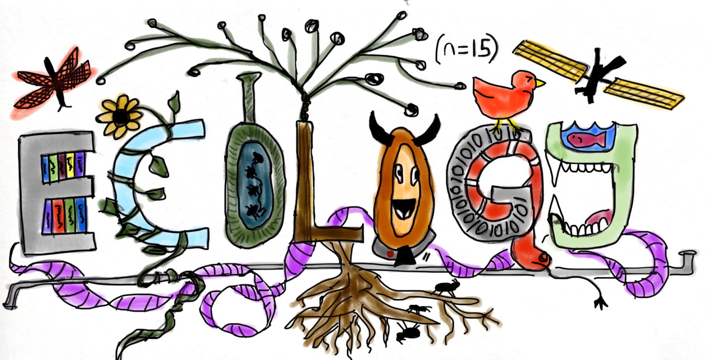

 

I am an emerging research ecologist with a focus on conservation, wildlife ecology, and spatial data science. In the long term I plan to work in academia, non-profit or government positions to help answer applied conservation questions by **bridging field-based work with new quantitative methods and spatial dimensions.** I believe in a world of rapid global change, quantitive methods are integral tools in applied conservation research. I also recognize that while these tools offer one way to view the natural world, decision making often requires multiple perspectives, and wish to uplift all views, particularly underrepresented views with my support.  

Currently, I am most interested in **research on the effect of anthropogenic change(s) on ecological systems.** I like to connect these findings with a broader ecological context and build questions reciprocally between theory and application that can ultimately inform policy. Traditionally, I have focused on the effects of anthropogenic change on ecosystems through the lens of animal behavior, but am interested in how these effects scale into demographic and ecosystem consequences.  

I have contributed to research on mammals, waterfowl, raptors, songbirds, tropical ecosystems, and landscape ecology. **My experience spans years of fieldwork across diverse regions, from the Western US to the Alaskan Arctic to the Brazilian Amazon. In the lab I have developed a diverse toolkit in statistics, super-computing, and spatial data analysis to help bridge the gap between the field, the analysis, and ultimately the insights.** Additionally, my background as a Pro Ski Patroller, SAR Member, and EMT provides essential risk management in high-stakes fieldwork. 

Lastly, **we can continually improve how we support our community**. Conservation and justice are tied together. Environmental change has historically impacted the most marginalized people first and will continue to do so. **As we develop solutions to global changes we must include and support all perspectives. Often, this can come from diverse perspectives within positions of power, such as scientists.** From my place of privilege I am dedicated to supporting others wherever possible and a fostering a sense of belonging. Second, **a way I would like to grow in the next 5 years is to better facilitate science communication and bridge highly-specific ecological methods to the public eye** in hope to add transparency to ecology. Public trust in science continues to erode, and encouraging the support of research and science-guided policy is fundamental to the wellbeing of our planet and people. **I have provided a plain language research statement below:**  

**Plain language research statement:** _Hi, my name is Jayden. I am a scientist who studies how animals and their environment are connected. I look at how animals change their behavior, how they move, and how they choose their habitats. I believe that understanding these connections can help us make better decisions to protect wildlife. I enjoy sharing my findings with others to raise awareness about the importance of conservation. My goal is to inspire people to care about and protect the natural world. By working together and prioritizing nature, we can make a difference for the ecosystem we are a part of, which supports human well being, animals, and our planet._] 

<a href="{{ site.baseurl }}inforedacted_JSkelly_CV_abridged.pdf">Download my CV here</a>.  
<embed src="{{ site.baseurl }}inforedacted_JSkelly_CV_abridged.pdf" type="application/pdf" width="100%" height="600px" />

[Back to Home](/)
